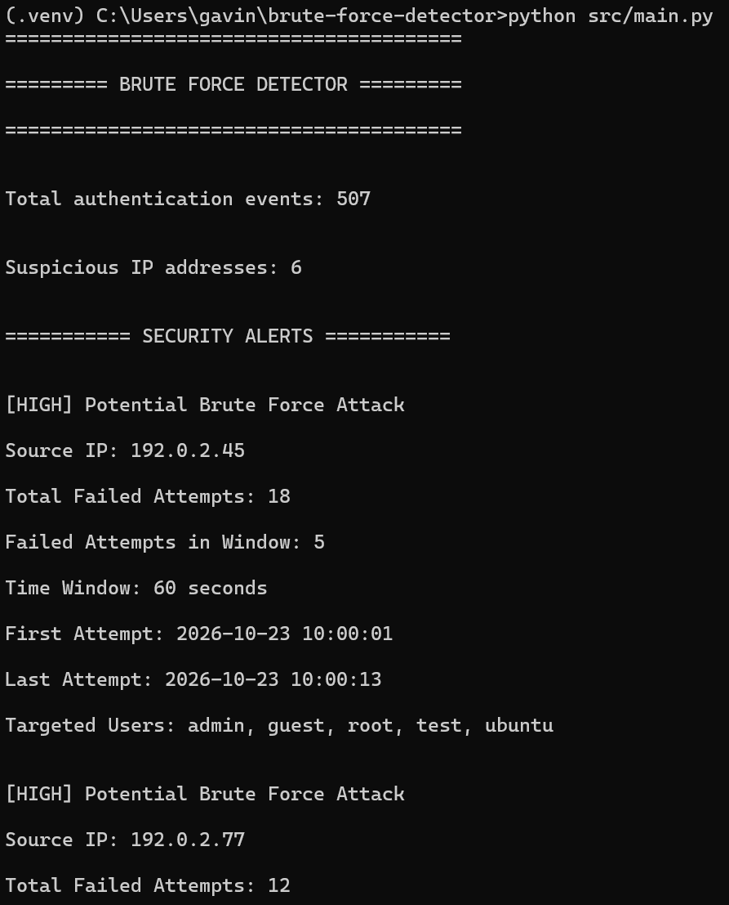
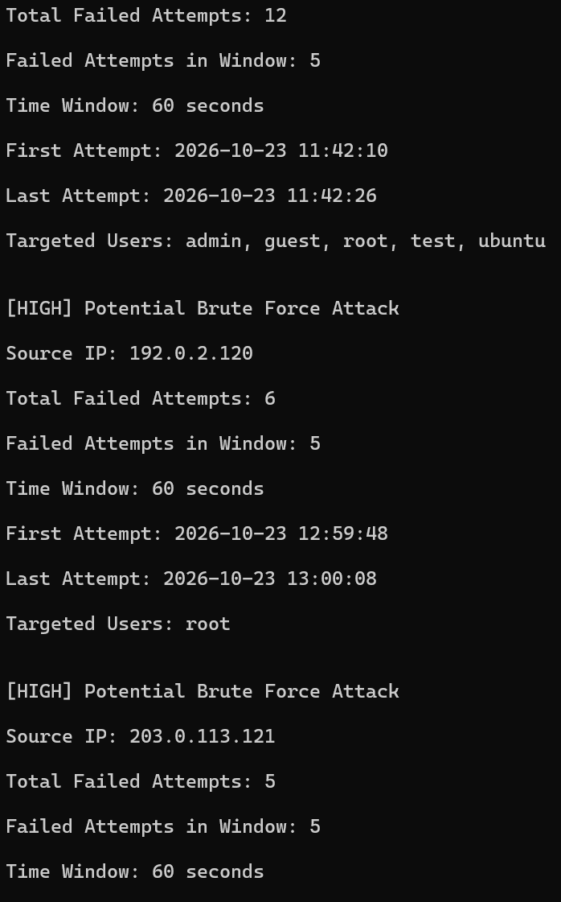
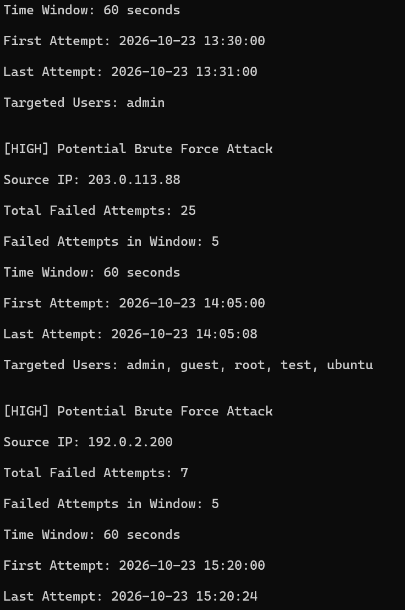
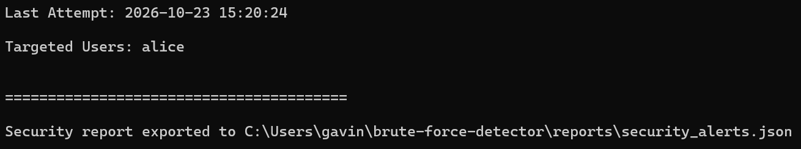
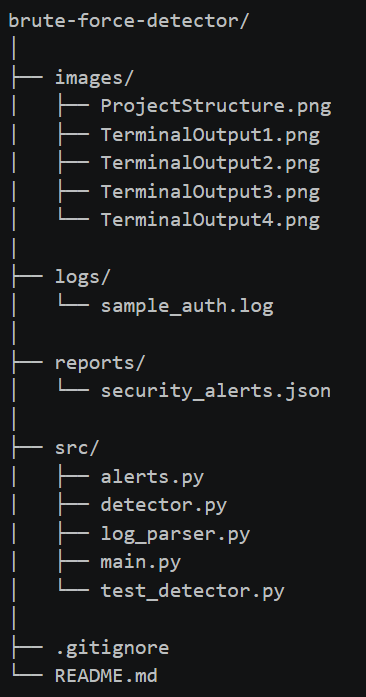

# Overview
Brute Force Detector is a Python-based cybersecurity tool designed to identify potential SSH brute-force attacks by analyzing authentication logs. It examines failed login attempts from individual IP addresses and detects suspicious activity when the number of failures exceeds a configurable threshold within a specified time window. The project was developed to explore how security professionals use authentication logs to identify potentially malicious activity, investigate suspicious login patterns, and detect unauthorized access attempts. This tool demonstrates fundamental security monitoring and threat detection concepts commonly used by Security Operations Center (SOC) analysts, system administrators, and cybersecurity professionals.

# Features
SSH Log Parsing: Extracts timestamps, source IP addresses, usernames, and authentication results from SSH authentication logs.
Brute-Force Detection: Identifies IP addresses generating repeated failed login attempts within a configurable time window.
Sliding-Window Algorithm: Analyzes authentication attempts based on their timestamps rather than relying solely on total failure counts.
Configurable Detection Settings: Allows users to specify a log file, failure threshold, and detection time window through command-line arguments.
Security Alert Generation: Displays suspicious IP addresses, total failed attempts, attempts within the detection window, timestamps, and targeted usernames.
JSON Report Export: Saves detected security alerts to a structured JSON file for further analysis.
Input Validation and Error Handling: Handles invalid command-line arguments, missing files, unreadable files, and logs containing no valid authentication events.
Automated Unit Testing: Includes tests for detection thresholds, time-window boundaries, successful logins, unsorted events, and multiple IP addresses.

# Tools & Technologies
Python 3: Primary programming language used to develop the application.

Regular Expressions (re): Extracts authentication information from SSH log entries.

datetime: Processes timestamps and calculates intervals between authentication attempts.

collections.defaultdict: Groups failed login attempts by source IP address.

ipaddress: Validates IP addresses extracted from authentication logs.

argparse: Provides configurable command-line arguments.

json: Exports detected security alerts in JSON format.

pathlib: Handles file paths and report directories.

unittest: Tests the brute-force detection algorithm and its behavior under different conditions.

Git & GitHub: Used for version control, project documentation, and source code management.

# Setup & Installation
Prerequisites:
	Python 3 installed.
	Git installed for cloning repo.

## 1. Clone the Repository
git clone https://github.com/Gavin-Main/brute-force-detector.git
cd brute-force-detector

## 2. Create a Virtual Environment (Optional)
On Windows:
python -m venv .venv
.venv\Scripts\activate

On macOS/Linux:
python3 -m venv .venv
source .venv/bin/activate

## 3. Run the Application
The project uses Python's standard library, so no additional Python packages are required.

From the project root directory, run:
python src/main.py

# Usage Examples
Run the detector with its default settings:
python src/main.py

## Default Configuration: 
Log File: logs/sample_auth.log
Failed Login Threshold: 5
Detection Time Window: 60 seconds

## Custom Configuration:
Change the number of failed attempts required to trigger an alert:
python src/main.py --threshold [desired number]

Change the detection window (in seconds):
python src/main.py --window [desired number]

Analyze a different SSH authentication log:
python src/main.py --file logs/[your log file]
Note: The supplied file must use the SSH authentication log format supported by the parser

You can customize all 3 settings simultaneously:
python src/main.py --file logs/sample_auth.log --threshold 10 --window 120

## Display Available Arguments:
	python src/main.py --help

Terminal Output 1:

Terminal Output 2:

Terminal Output 3: 

Terminal Output 4:

## JSON Security Reports
After analyzing an authentication log, the application automatically generates a JSON report at: reports/security_alerts.json
Each detected threat includes information such as:
Source IP address
Total failed login attempts
Failed attempts within the detection window
Configured detection window
First and last timestamps of the triggering window
Targeted usernames
Alert severity

## Detection Methodology
The application uses a sliding-window detection algorithm to identify potential SSH brute-force attacks.

The detection process follows these steps:

Read and parse authentication events from the specified SSH log file.

Extract failed authentication attempts and group them by source IP address.

Sort each IP address's failed attempts chronologically.

Examine consecutive attempts within the configured time window.

Generate an alert when the number of failed attempts reaches the configured threshold.

Display detected threats and export the results to a JSON report.

By default, an alert is generated when an IP address produces five or more failed login attempts within 60 seconds.

The algorithm uses timestamps rather than fixed clock-minute boundaries, allowing it to detect suspicious activity even when authentication attempts span different minutes.

# Project Structure

## Source Files
src/main.py: Serves as the application's entry point. Processes command-line arguments, validates user input, coordinates log analysis, and initiates security reporting.

src/log_parser.py: Reads SSH authentication logs and extracts structured information, including timestamps, IP addresses, usernames, and authentication results.

src/detector.py: Groups failed authentication attempts by IP address and applies a sliding-window algorithm to identify potential brute-force attacks.

src/alerts.py: Formats security alerts for terminal output and exports detected threats to JSON reports.

src/test_detector.py: Contains automated unit tests that verify detection behavior and important edge cases.

## Supporting Files and Directories
logs/sample_auth.log: Contains synthetic SSH authentication events used to demonstrate and test the detection algorithm.

reports/: Stores generated JSON security reports.

images/: Contains screenshots demonstrating the application's functionality and project structure.

README.md: Provides project documentation, setup instructions, usage examples, and technical explanations.

.gitignore: Excludes temporary files, virtual environments, and generated reports from version control.

# Testing
The project includes automated unit tests written using Python's built-in unittest framework.

To execute the tests, run:
python src/test_detector.py -v

The test suite verifies:
Detection of five failed attempts within 60 seconds.

No alert when failed attempts remain below the configured threshold.

No alert when attempts are spread outside the detection window.

Correct detection when attempts span exactly 60 seconds.

Exclusion of successful authentication events from failure counts.

Correct processing of authentication events supplied out of chronological order.

Independent detection of suspicious activity from multiple IP addresses.

# Security Context / Learning Outcomes
This project demonstrates several cybersecurity concepts relevant to security monitoring, intrusion detection, and incident investigation:

Authentication Log Analysis: Authentication logs provide valuable information about login activity, including failed attempts, targeted accounts, and source IP addresses. Analyzing these records can help security analysts recognize suspicious patterns and investigate potential unauthorized access attempts.

Brute Force Attack Detection: Brute-force attacks involve repeated authentication attempts intended to gain unauthorized access to an account or system. By detecting multiple failed login attempts within a short period, this project demonstrates how automated monitoring can identify activity consistent with password-guessing attacks.

Threshold-Based Detection: This project uses configurable thresholds to determine when authentication activity should generate an alert. Adjusting these thresholds illustrates the balance between detecting suspicious behavior and reducing false positives.

Time-Based Event Correlation: The sliding-window algorithm correlates authentication events based on their timestamps. This demonstrates how security monitoring tools can identify suspicious patterns across multiple log entries rather than analyzing each event independently.

Security Alerting and Reporting: This project generates structured security alerts containing relevant investigation details, including source IP addresses, timestamps, failed login counts, and targeted usernames. Exporting these results to JSON demonstrates a common approach to producing machine-readable security data that could be integrated into other monitoring or analysis workflows.

Automated Testing and Secure Software Development: The project includes unit tests and input validation to improve reliability. Testing edge cases such as exact time-window boundaries and out-of-order events helps ensure that the detection algorithm behaves consistently

# Future Improvements
Real-Time Log Monitoring: Extend the application to monitor authentication logs continuously rather than analyzing files only when the program runs.

Email or Slack Notifications: Send alerts to security personnel when suspicious activity is detected.

Additional Log Formats: Support different SSH log formats and authentication logs from other operating systems or services.

Configurable Alert Severity: Assign different severity levels based on the frequency and volume of failed login attempts.

Advanced Detection Metrics: Report the maximum number of failed attempts observed within any detection window, rather than only the first qualifying window.

Successful Login Correlation: Identify successful authentications that occur after repeated failures from the same IP address.

GeoIP Enrichment: Add geographic context to suspicious IP addresses to assist with security investigations.

SIEM Integration: Export or forward alerts to security monitoring platforms such as Elasticsearch or Splunk.

Docker Support: Containerize the application to simplify deployment across different environments.

# References
MITRE ATT&CK — Brute Force (T1110) — Describes brute-force techniques used by adversaries to obtain account credentials.

# Disclaimer
This project is intended for educational purposes and uses synthetic SSH authentication logs. Detected patterns indicate potentially suspicious behavior and do not independently confirm that an attack occurred.

